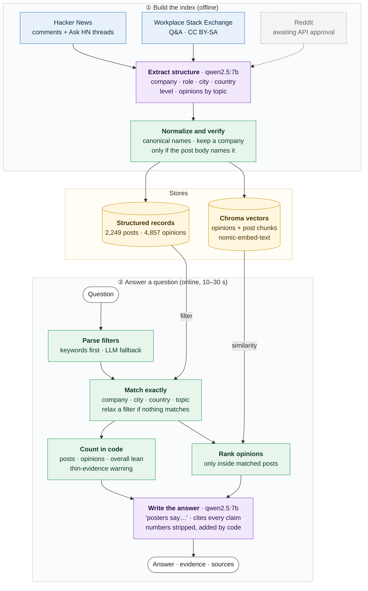

# Workplace insights RAG

Ask what people actually say about working somewhere, e.g. *"How is work-life balance for SDEs at TCS in Hyderabad?"*,
and get an answer built from community discussions, with **counts and citations** instead of a vague summary.

<!-- Screenshot: save as docs/screenshot.png, then replace this comment with:
 -->

> Status: 🚧 MVP. Hacker News and Workplace Stack Exchange sources working; Reddit source next.

## Why not just ask Glassdoor or ChatGPT?

- Posts are messy free text. Before indexing, a local LLM **extracts structure** from each one: company, role, city,
  country, experience level, and per-topic opinions with sentiment.
- Questions about a country ("in India…") filter on it; with a company named, country only excludes posts
  that say they are about somewhere else.
- Questions are turned into **exact filters** over that structure, so "TCS in Hyderabad" really means posts about TCS
  in Hyderabad, not whatever is semantically nearby.
- Evidence counts are computed over **all** matching posts, not just the top-k retrieved ones, and the overall
  lean of their opinions steers the answer's wording. No "% negative" score is shown: forum posts skew
  negative, so it would read like a company rating it isn't.
- When evidence is thin, the answer says so: *"based on only N posts"*. If nothing matches, filters are relaxed one
  at a time and the answer reports which were dropped.
- Answers are phrased as *"posters say…"*, never as facts about a company.

## Architecture



Colours: 🟦 data sources · 🟪 LLM steps (qwen2.5:7b) · 🟩 deterministic code · 🟨 stores. The LLM extracts and writes; everything that must be exact (matching, counts, the lean) is plain code, and filter parsing only falls back to the LLM when no keyword matches.

The LLM never does arithmetic: post and opinion counts, the overall lean and the thin-evidence warning are
computed in code, and number sentences are stripped from the generated text.

## Pipeline

```
ingest_hn.py              keyword search over HN comments           ->  data/raw/hn.jsonl
ingest_hn_threads.py      whole "Ask HN" workplace threads          ->  data/raw/hn_threads.jsonl
ingest_stackexchange.py   The Workplace Stack Exchange Q&A (no key) ->  data/raw/stackexchange.jsonl
ingest_reddit.py          Reddit Data API (needs keys in .env)      ->  data/raw/reddit.jsonl
extract.py                qwen2.5:7b (Ollama), JSON-schema output   ->  data/processed/posts.jsonl
index.py                  nomic-embed-text -> Chroma: post chunks + one document per extracted opinion
query.py                  question -> filters -> matching posts -> counts + top opinions -> cited answer
evaluate.py               retrieval relevance on a labelled question set
```

Retrieval ranks the short extracted opinions ("TCS: managers expect weekend calls") rather than whole
posts, so a long comment that mentions a company once can't outrank a post that is actually about the question.
A company tag is only kept if the post really names it (so "my 7 figure TCs" is not read as TCS).

## Evaluation

15 questions with intended filters (`eval/questions.json`); each cited source is labelled relevant or not
(`eval/labels.jsonl`, ids only, no post text). Relevant = the post says something about that company (or city)
on that topic.

| Retrieval | Data | Precision@5 | Precision@3 | Top source relevant |
|---|---|---|---|---|
| Whole-post chunks (v1) | HN keyword search | 48% | 55% | 67% |
| Extracted opinions (v2) | HN keyword search | 51% | 55% | 73% |
| Extracted opinions (v2) | + Ask HN threads, body-only company check | 53% | 61% | 67% |

What moved the numbers:
- Ask HN threads tripled the matching posts for Big Tech (Google career growth 19 -> 109, Meta WLB 5 -> 24)
  and lifted Meta WLB from 1/5 to 4/5 relevant sources.
- Crediting a company only when the post body names it (not the thread title) removed replies like
  "here is what I make at my job" in "Ask HN: How much do you make at Amazon?".
- Indian IT (TCS, Infosys, Wipro) did not improve: Ask HN barely discusses them. Reddit is the fix.

Workplace Stack Exchange (first 54 of 646 prefiltered posts extracted so far) left these scores unchanged: it
rarely names employers, so it helps India/topic questions ("notice periods in India") rather than the
company questions in this set.

With 15 questions, one question changing its top source moves "top source relevant" by ~7 points.

```bash
python -m workplace_rag.evaluate run --mode opinion
python -m workplace_rag.evaluate label     # prints sources that still need a label
python -m workplace_rag.evaluate score
```

Everything runs locally and free (tested on an RTX 5060 Laptop GPU with 8 GB of VRAM).

## Run it

```bash
python -m venv .venv
.venv/Scripts/activate      # Windows; use source .venv/bin/activate elsewhere
pip install -r requirements.txt
ollama pull qwen2.5:7b && ollama pull nomic-embed-text

python -m workplace_rag.ingest_hn --pages 1
python -m workplace_rag.extract            # resumable, ~3 s/post
python -m workplace_rag.index
python -m workplace_rag.cli --stats
python -m workplace_rag.cli "How is work life balance at TCS?"

streamlit run streamlit_app.py             # web UI at http://localhost:8501
```

The web UI shows the detected filters (which you can override), matching post and opinion counts,
a thin-evidence warning, the answer, and each cited source with its extracted opinions.

## Data and ethics

- Sources: official APIs only (Hacker News via Algolia; The Workplace Stack Exchange via the Stack Exchange API;
  Reddit Data API with app-only, read-only auth). No Glassdoor/AmbitionBox scraping.
- Stack Exchange content is CC BY-SA: every cited source links back to the original question or answer.
- Author names are not stored. Raw data is never committed (`data/` is gitignored).
- Non-commercial project for learning.

## Roadmap

- [x] Streamlit UI
- [x] Retrieval relevance eval + opinion-level retrieval
- [x] Ask HN thread source
- [x] Workplace Stack Exchange source (India-focused queries + `india` tag)
- [ ] Reddit source (code ready; needs API keys)
- [ ] Supporting quote per opinion + first-hand flag in extraction
- [ ] Extraction accuracy (~200 hand-labelled posts), answer faithfulness, Stack Overflow survey benchmarks
